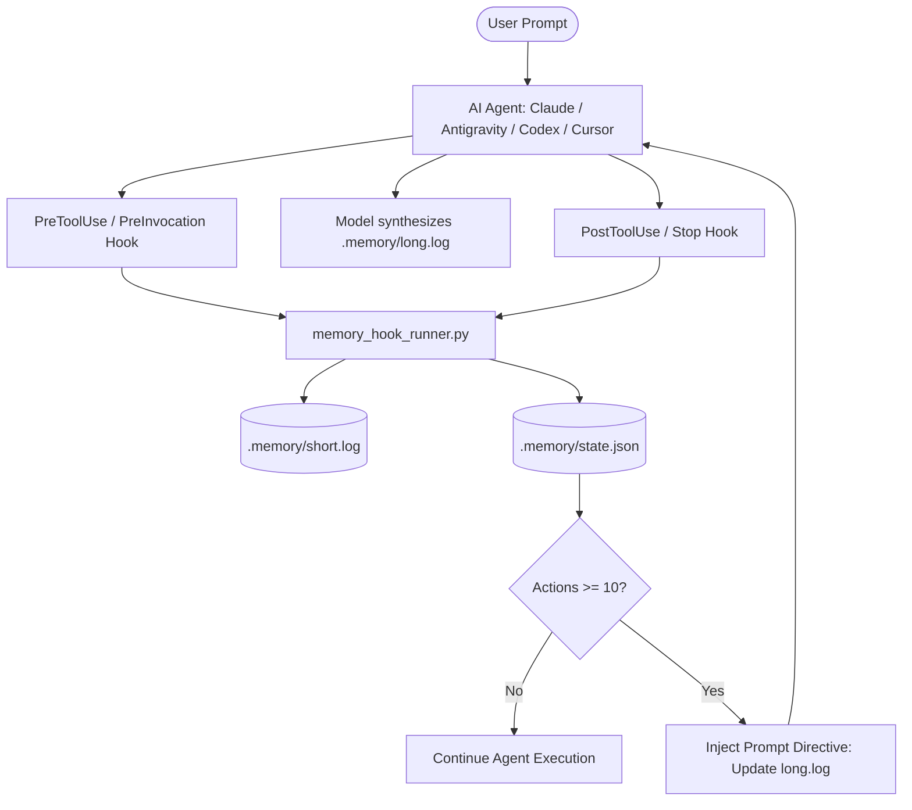

# memory-hook

[]()
[](https://opensource.org/licenses/MIT)
[]()

> A universal, downloadable lifecycle hook that bridges context across AI coding agents (**Claude Code**, **Antigravity**, **OpenAI Codex**, and **Cursor**).

Never re-explain your project again when switching between different agentic CLI tools or IDE assistants.

---

## The Problem It Solves

Developers frequently switch between different AI agents:
- You start a complex architectural refactor in **Antigravity**.
- You move to **Claude Code** for fast terminal editing and bash tasks.
- You open **Cursor** or **OpenAI Codex** for code completions or specific model evaluations.

**The pain:** Every time you switch, the new agent starts with zero knowledge of what the previous agent planned, tested, discovered, or decided.

**The solution:** `memory-hook` installs lightweight deterministic lifecycle hooks into your repository. It intercepts model responses, user prompts, tool requests, and tool results, preserving context in a structured `.memory/` directory that any agent immediately understands.

---

## Key Features

- **Cross-Provider Compatibility**: Native support for **Antigravity** (`.agents/hooks.json`), **Claude Code** (`.claude/settings.json`), **OpenAI Codex** (`.codex/hooks.json`), and **Cursor** (`.cursor/hooks.json`).
- **Deterministic Event Stream (`.memory/short.log`)**: Records every action, tool parameter, tool result, and model response in append-only JSON Lines format.
- **Agentic Knowledge Synthesis (`.memory/long.log`)**: Distills project identity, architecture, active tasks, and decisions into high-density Markdown.
- **Automated 10-Message Compaction Cycle**: After every 10 events, the hook injects a prompt directive instructing the active agent to synthesize recent progress into `long.log`.
- **Zero-Dependency & Self-Contained**: Generates a standalone runner (`.memory/bin/memory_hook_runner.py`) using only Python standard library.
- **Provider-Specific Instruction Injection**: Generates and manages `AGENTS.md`, `CLAUDE.md`, `CODEX.md`, and `.cursorrules`.

---

## Directory Structure

When installed into a project, `memory-hook` creates:

```
<your-project>/
├── .memory/
│   ├── short.log               # Append-only deterministic event log (JSONL)
│   ├── long.log                # Distilled, high-density project memory (Markdown)
│   ├── state.json              # Event sequence counter and compaction checkpoints
│   └── bin/
│       └── memory_hook_runner.py # Portable zero-dependency hook runner
├── .agents/                    # Antigravity hook bindings
│   └── hooks.json
├── AGENTS.md                   # Antigravity context restoration instructions
├── .claude/                    # Claude Code hook bindings
│   └── settings.json
├── CLAUDE.md                   # Claude Code context restoration instructions
├── .codex/                     # OpenAI Codex hook bindings
│   └── hooks.json
├── CODEX.md                    # Codex instructions
├── .cursor/                    # Cursor hook bindings
│   └── hooks.json
└── .cursorrules                # Cursor instructions
```

---

## Quick Start & Installation

### Option 1: One-Line Installer

#### Linux / macOS:
```bash
curl -fsSL https://raw.githubusercontent.com/subhasishsaha/memory-hook-for-agents/main/install.sh | bash
```

#### Windows (PowerShell):
```powershell
irm https://raw.githubusercontent.com/subhasishsaha/memory-hook-for-agents/main/install.ps1 | iex
```

---

### Option 2: Python / Pip

```bash
# Install globally or in virtualenv
pip install memory-hook

# Install into current project
memory-hook install

# Or install for a specific provider only
memory-hook install --provider claude
memory-hook install --provider antigravity
```

---

### Option 3: NPX / Node.js

```bash
npx memory-hook install
```

---

## How It Works



### Event Normalization Schema (`short.log`)

Every intercepted event is appended as a single JSON object:

```json
{
  "seq": 14,
  "ts": "2026-11-18T00:15:30.120Z",
  "provider": "antigravity",
  "session_id": "ec33ebf9-0cba-4100-8142-c61503f6c587",
  "turn_id": 12,
  "type": "tool_call",
  "payload": {
    "call_id": "call_123",
    "tool_name": "run_command",
    "args": { "CommandLine": "npm test" }
  },
  "truncated": false
}
```

### Event Types:
- `user_request`: Prompts and instructions submitted by the user.
- `tool_call`: Tool invocation parameters emitted by the agent.
- `tool_result`: Output or error returned by the executed tool.
- `model_response`: Natural language response emitted by the model.

---

## CLI Commands

```bash
# Check memory hook status, event counters, and compaction health
memory-hook status

# Inspect recent short.log events
memory-hook inspect --tail 10

# Print current long-term memory summary
memory-hook inspect --long

# Reinstall or reconfigure providers
memory-hook install --provider all
```

---

## Running Tests

The test suite runs with standard Python `unittest`:

```bash
python -m unittest discover tests
```

---

## License

MIT © [Memory Hook Contributors](LICENSE)
