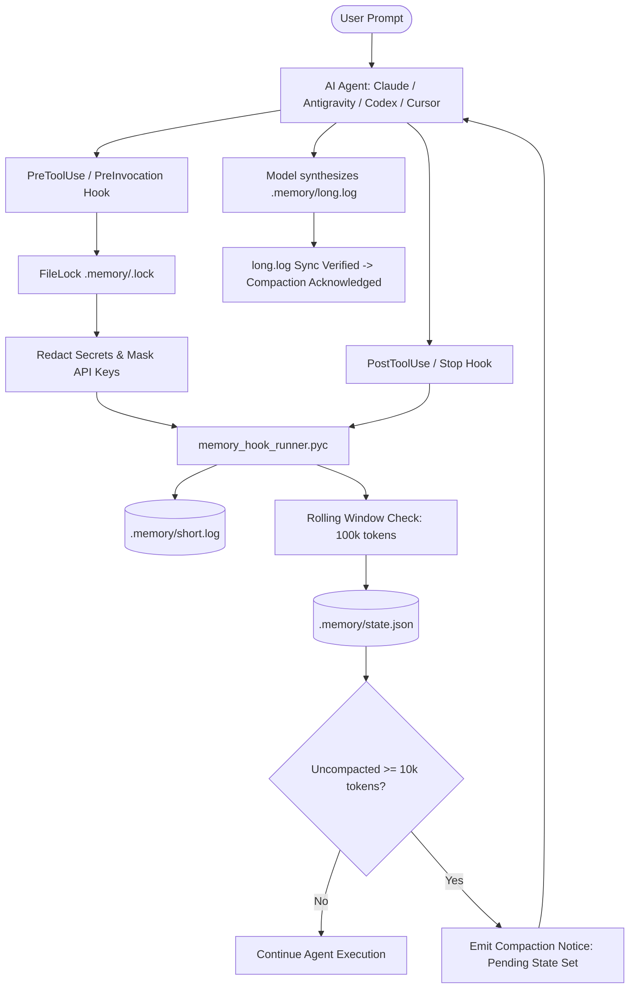

# memory-hook

[](https://github.com/subhasishsaha/memory-hook-for-agents/releases/tag/v0.1.0)
[]()
[]()
[](https://opensource.org/licenses/MIT)
[]()

> A universal, downloadable lifecycle hook that bridges context across AI coding agents (**Claude Code**, **Antigravity**, **OpenAI Codex**, and **Cursor**).

Never re-explain your project again when switching between different agentic CLI tools or IDE assistants.

---

## The Problem It Solves

Developers frequently switch between different AI agents:
- You start a complex architectural refactor in **Antigravity**.
- You move to **Claude Code** for fast terminal editing and bash tasks.
- You open **Cursor** or **OpenAI Codex** for code completions or specific model evaluations.

**The pain:** Every time you switch, the new agent starts with zero knowledge of what the previous agent planned, tested, discovered, or decided.

**The solution:** `memory-hook` installs lightweight deterministic lifecycle hooks into your repository. It intercepts model responses, user prompts, tool requests, and tool results, preserving context in a structured `.memory/` directory that any agent immediately understands.

---

## Key Features

- **Cross-Provider Compatibility**: Native support for **Antigravity** (`.agents/hooks.json`), **Claude Code** (`.claude/settings.json`), **OpenAI Codex** (`.codex/hooks.json`), and **Cursor** (`.cursor/hooks.json`).
- **Antigravity Customization Protocol**: Fully aligned with Antigravity lifecycle hooks (`PreInvocation`, `PreToolUse`, `PostToolUse`, `Stop`, and `SessionStart`) using canonical wildcard matchers (`"matcher": "*"`) and portable multi-platform Python interpreter resolution.
- **Zero-Leak Cross-Process File Locking**: Concurrency-safe write transactions using low-level OS file descriptors (`msvcrt` on Windows, `fcntl` on Unix) with deterministic destructor cleanup and `BaseException` protection against file descriptor leaks.
- **Deterministic Event Stream (`.memory/short.log`)**: Records actions, tool parameters, tool results, and model responses in a rolling JSONL event journal.
- **100k Token Rolling Context Window**: Automatically prunes older entries from `.memory/short.log` to preserve a rolling 100,000 token context window, preventing file bloat and runaway context while protecting uncompacted events.
- **Automatic Secret & Credential Redaction**: Pattern-based masking redacts OpenAI/Anthropic/Google/AWS/GitHub API keys, tokens, bearer headers, private keys, passwords, and `.env` files into `[REDACTED:...]` markers before writing to disk.
- **Compaction Acknowledgement Protocol**: Compaction requests remain `pending` until long-term memory synthesis is verified in `.memory/long.log` or explicitly acknowledged. Pending compactions are never prematurely marked as completed and automatically retry across sessions.
- **Agentic Knowledge Synthesis (`.memory/long.log`)**: Distills project identity, architecture, active tasks, and decisions into high-density Markdown.
- **Token-Based Compaction Trigger (10k Tokens)**: Whenever $\ge 10{,}000$ estimated tokens accumulate since the last synthesis, the hook injects a prompt directive instructing the active agent to distill recent progress into `long.log`.
- **Non-Destructive Configuration Merging**: Merges hooks into existing `.agents/hooks.json`, `.claude/settings.json`, `.codex/hooks.json`, and `.cursor/hooks.json` files, preserving unrelated user hooks and settings. Automatically creates `.bak` backups before modifying files.
- **State Validation & Journal Recovery**: Detects corrupted `state.json` files, creates a timestamped corrupt backup (`state.json.corrupt.<ts>`), and automatically reconstructs sequence counters and token metrics directly from `short.log`.
- **Journal-First Crash Consistency & Durable Sync**: Write-ahead appending to `short.log` with atomic state commits and directory-level synchronization (`safe_fsync_dir` on POSIX) preserves journal and state consistency across process crashes. Safe tail-recovery automatically repairs incomplete records from interrupted writes.
- **Local Bytecode Compilation & Accidental-Edit Lock**: Ships clean Python source code, compiles `.pyc` locally on the user's system at install time, deletes `.py` source, and marks `.memory/bin/memory_hook_runner.pyc` with OS-level read-only permissions (`attrib +R` / `chmod 0o555`) to prevent coding agents from accidentally modifying runner scripts.
- **Zero Runtime Dependencies**: Works entirely with Python 3.10+ standard library. No external pip dependencies required at runtime.
- **Production-Grade Node.js Wrapper**: NPX wrapper (`bin/index.js`) forwards signals (`SIGINT`/`SIGTERM`) and provides clear diagnostic error messages if Python 3 is missing.

---

## Directory Structure

When installed into a project, `memory-hook` creates:

```
<your-project>/
├── .memory/
│   ├── short.log                 # Rolling context event log (JSONL, capped at 100k tokens)
│   ├── long.log                  # Distilled, high-density project memory (Markdown)
│   ├── state.json                # Sequence counters, token accounting, and compaction checkpoints
│   ├── .lock                     # Standard library cross-process lock file
│   └── bin/
│       └── memory_hook_runner.pyc # Locally compiled bytecode runner (accidental-edit locked)
├── .agents/                      # Antigravity hook bindings
│   └── hooks.json
├── AGENTS.md                     # Antigravity context restoration instructions
├── .claude/                      # Claude Code hook bindings
│   └── settings.json
├── CLAUDE.md                     # Claude Code context restoration instructions
├── .codex/                       # OpenAI Codex hook bindings
│   └── hooks.json
├── CODEX.md                      # Codex instructions
├── .cursor/                      # Cursor hook bindings
│   └── hooks.json
└── .cursorrules                  # Cursor instructions
```

---

## Quick Start & Installation

> **Requirements**: Python 3.10+ (Standard library only; zero external pip dependencies required).

### Option 1: NPX (Fastest — Zero Pre-Installation)

Run directly in any repository without installing anything beforehand:
```bash
npx memory-hook install
```

---

### Option 2: One-Line Standalone Installer

#### Linux / macOS:
```bash
curl -fsSL https://raw.githubusercontent.com/subhasishsaha/memory-hook-for-agents/main/install.sh | bash
```

#### Windows (PowerShell):
```powershell
irm https://raw.githubusercontent.com/subhasishsaha/memory-hook-for-agents/main/install.ps1 | iex
```

Or run directly with Python:
```bash
python install.py /path/to/project
```

To preview changes without touching any files:
```bash
python install.py /path/to/project --dry-run
```

---

### Option 3: Python / Pip CLI

```bash
# Install via pip
pip install memory-hook

# Or install directly from GitHub
pip install git+https://github.com/subhasishsaha/memory-hook-for-agents.git

# Install into current project (non-destructively merges into existing configs)
memory-hook install

# Or preview changes first
memory-hook install --dry-run

# Or install for a specific provider only
memory-hook install --provider antigravity
memory-hook install --provider claude
```

---

## How It Works



### Event Normalization Schema (`short.log`)

Every intercepted event is appended as a sanitized single JSON object:

```json
{
  "seq": 14,
  "ts": "2026-11-18T00:15:30.120Z",
  "provider": "antigravity",
  "session_id": "ec33ebf9-0cba-4100-8142-c61503f6c587",
  "turn_id": 12,
  "type": "tool_call",
  "payload": {
    "call_id": "call_123",
    "tool_name": "run_command",
    "args": { "CommandLine": "npm test" }
  },
  "tokens": 28,
  "truncated": false
}
```

### Event Types:
- `user_request`: Prompts and instructions submitted by the user.
- `tool_call`: Tool invocation parameters emitted by the agent.
- `tool_result`: Output or error returned by the executed tool.
- `model_response`: Natural language response emitted by the model.

---

## Security Model & Threat Model

`memory-hook` is designed as **trusted local developer infrastructure**:

1. **Accidental-Edit Protection**: Compiling the runner into `.pyc` and setting read-only file attributes prevents LLM code editing tools from hallucinating edits or accidentally corrupting hook scripts during automated workflows. *Note: This is accidental-edit protection, not an operating-system sandbox against hostile processes running under the same user account.*
2. **Pre-Persistence Redaction Layer**: All event payloads pass through regex-based secret redaction before being appended to `short.log`. Common cloud credentials, OpenAI/Anthropic/GitHub/Google API keys, Bearer authorization headers, private key blocks, and `.env` file contents are automatically masked as `[REDACTED:...]`.
3. **Runner Binary Integrity Check**: `memory-hook status` computes the SHA-256 digest of `.memory/bin/memory_hook_runner.pyc` and verifies it against the recorded installation hash.
4. **Non-Destructive Safety**: Before modifying existing configuration files (`.agents/hooks.json`, `.claude/settings.json`, `.codex/hooks.json`, `.cursor/hooks.json`), a `.bak` backup copy is automatically created. Malformed configuration files are never overwritten.

---

## CLI Commands

```bash
# Check memory hook status, event counters, integrity, and pending compaction
memory-hook status

# Manually acknowledge a compaction through a specific sequence (use --force to override checkpoint)
memory-hook ack --seq 50
memory-hook ack --seq 50 --force

# Inspect recent short.log events (payloads masked by default for terminal privacy)
memory-hook inspect --tail 10

# Inspect recent events displaying full payload contents
memory-hook inspect --tail 10 --show-payload

# Print current long-term memory summary
memory-hook inspect --long

# Reinstall or reconfigure providers (with dry-run option)
memory-hook install --provider all --dry-run
```

---

## Running Tests

The test suite runs with standard Python `unittest`:

```bash
python -m unittest discover -s tests -p "test_*.py"
```

---

## License

MIT © [Subhasish Saha & Memory Hook Contributors](LICENSE)
